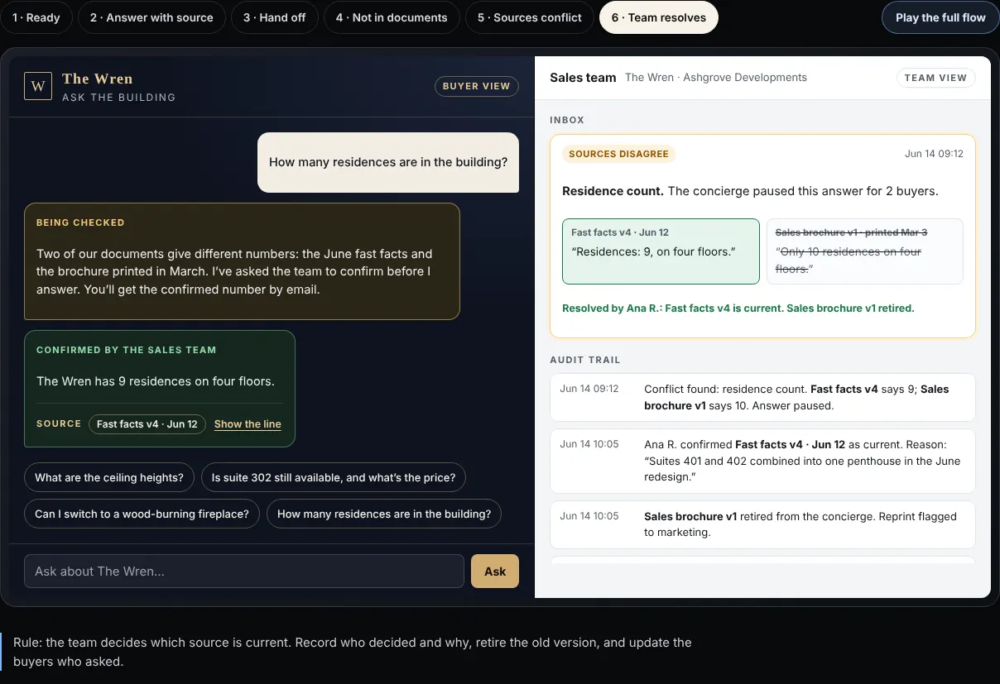

# Ask the building

A working prototype of a buyer concierge for preconstruction real estate. It answers only from the developer’s approved documents, shows the source and version with every answer, hands price and availability to a person, and stops when two documents disagree. The sales team’s view sits alongside the buyer’s.

**Try it:** [live demo and full case study](https://danielrilleyportfolio.netlify.app/urbo#demo) · or open `index.html` locally.

## Why

Preconstruction sales run on documents that change while the building is being sold: suite counts, layouts, finishes, dates. Buyers ask the same questions, agents answer by hand, and printed pieces go out of date. A buyer-facing AI that answers from whichever document it read first would repeat those mistakes at scale. This prototype designs for the cases that matter: sources, handoffs, gaps and conflicts.

## The six states

| State | Rule the interface keeps |
| --- | --- |
| 1 · Ready | Before the first question, say what the assistant has read and what it will not answer. |
| 2 · Answer with source | Answer only from approved documents, with the document, version and exact line. |
| 3 · Hand off | Price, availability and incentives go to a person, with the conversation if the buyer agrees. |
| 4 · Not in documents | Answer the part the documents cover, say what they don’t, and route the rest to the team. |
| 5 · Sources conflict | When two approved documents disagree, pause the answer, tell the buyer, alert the team. |
| 6 · Team resolves | The team picks the current source with a reason; the old version is retired and buyers who asked are updated. |

## Four decisions

1. **Approved documents only, with versions.** An answer without a version can’t be checked, and a wrong spec quoted to a buyer becomes a dispute.
2. **Price and availability always go to a person.** They change daily and are negotiated. With the conversation passed on, the agent doesn’t start from zero.
3. **A conflict stops the answer.** Picking either source is a coin toss, and the conflict itself is news: an out-of-date brochure is still in circulation.
4. **Every unknown becomes an approved answer.** The team answers each new question once, and the approved FAQ grows from real buyer questions.

## How it’s built

Plain HTML, CSS and JavaScript. No framework, no back end, no model calls: the answers are scripted so every state can be shown on demand. Free-text questions are routed by simple keyword rules to the matching state.

- `index.html` – page and prototype shell
- `concierge.js` – states, conversation, team inbox and audit trail
- `concierge.css` – buyer view (project brand) and team view
- `shell.css`, `page.css` – tabs, frame and page

I defined the states, the rules and the two-sided model, and directed the build. An AI coding assistant (Claude) wrote most of the code to that spec.

## Data

The Wren, Ashgrove Developments, the people and every document and number are invented. The real launch work behind the idea is shown in the [case study](https://danielrilleyportfolio.netlify.app/urbo).

## Related

[AI pricing assistant](https://github.com/danieldavidriley/ai-pricing-assistant): the same principles for analysts inside a data product.

## License

MIT © 2026 Daniel Riley
